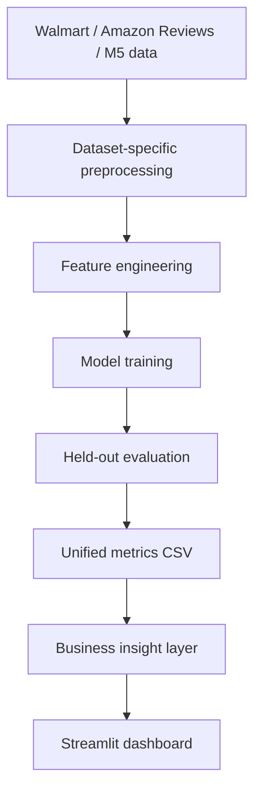

# System architecture

## Components
- Data layer: original public datasets stored locally.
- Preparation layer: cleaning, joining, encoding, text vectorization, and time features.
- Modeling layer: dataset-specific supervised learning models.
- Evaluation layer: task-appropriate metrics on held-out data.
- Presentation layer: interactive Streamlit exploration of measured results.

The diagram describes the intended project workflow. Update it if your final implementation differs.
